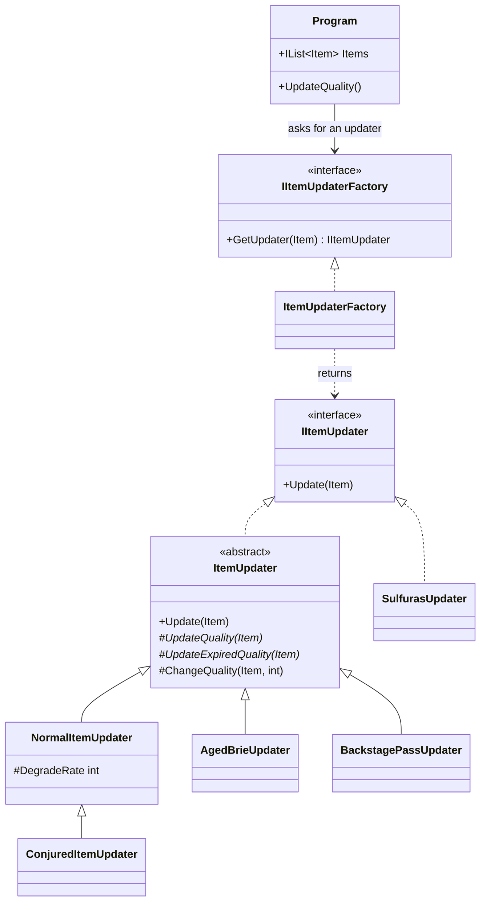
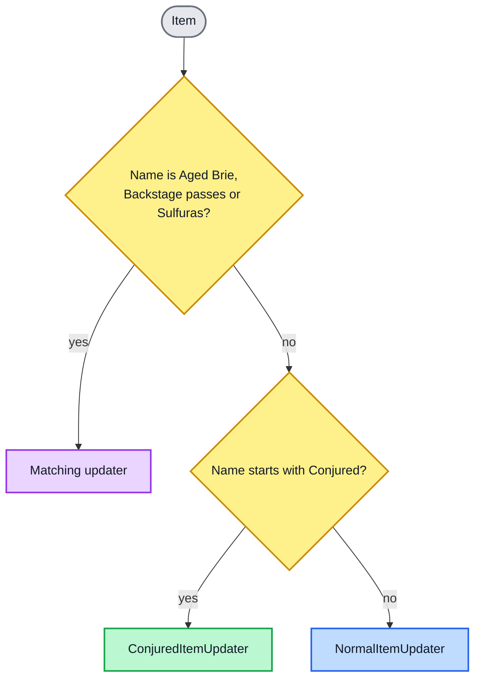
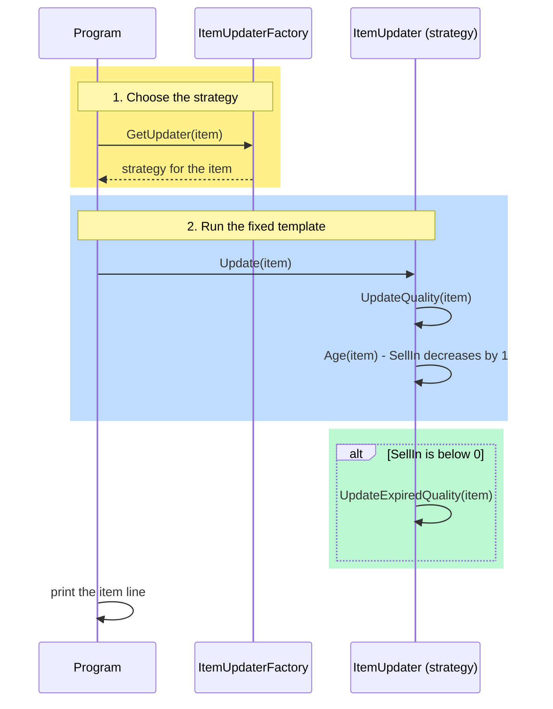

# Exercise 2: Gilded Rose Refactoring Kata - Solution Notes

## Task
Add support for **Conjured** items (they degrade in Quality twice as fast as normal items) to the
inventory update system, without altering the `Item` class or the `Items` property.

## Approach
1. Documented the legacy rules as comments and pinned the existing behaviour with tests.
2. Replaced the nested conditionals in `UpdateQuality` with **Strategy + Factory + Template Method**.
3. Added Conjured as a new strategy.

```
src/GildedRose.Console
├── Program.cs                        client: loops items, asks the factory for a strategy
└── Updaters
    ├── Abstractions                  IItemUpdater, IItemUpdaterFactory, ItemUpdater (template base)
    ├── Strategies                    Normal, Conjured, AgedBrie, BackstagePass, Sulfuras
    └── Factory                       ItemUpdaterFactory
```

## Design diagrams

**Colour key:** grey = client, yellow = factory, blue = interfaces (contracts), orange = template base
class, green = strategies built on the template, purple = strategy implemented directly.

### Class diagram
`Program` depends only on the two interfaces. The Template Method (`ItemUpdater`) holds the shared
steps, and the strategies override only what differs. `SulfurasUpdater` implements the strategy
interface directly because none of the daily steps apply to it.



### How the factory picks an updater


### One day's update (Template Method)


## Design decisions
- **Strategy**: one class per item category, so each rule is isolated and testable (SRP) and a new
  category is a new class (Open/Closed).
- **Template Method** (`ItemUpdater`): fixes the daily order - quality change, SellIn decrement,
  extra change once expired - and keeps the 0-50 Quality bounds in one helper.
- **Factory**: maps an item to its strategy (exact name lookup, then the `Conjured` prefix, then
  normal). Strategies are stateless, so one shared instance is reused for every item.
- **Conjured** extends `NormalItemUpdater` and overrides only the degrade rate.
- **Sulfuras** implements `IItemUpdater` directly because none of the daily steps apply to it.
- **Constants** are named for their role (e.g. `CriticalThreshold`), not their value, so a rule
  change edits one constant.
- `Program` receives the factory through its constructor (default: `ItemUpdaterFactory`).
- `Item` and `Items` are unchanged.

## Assumptions
- Conjured items also degrade twice as fast **after** the sell-by date (4 per day), i.e. the
  normal expired rate is doubled too. The README does not say.
- Conjured items are recognised by the name prefix `Conjured`.
- Names are matched exactly and case-sensitively; anything unrecognised is a normal item.
- Legacy behaviour is preserved, including items whose Quality is already above 50 (not clamped
  down by increases).

## Trade-offs

- **More files for a small problem.**
  The old code was one long method. Now each rule has its own small class, so there are more files
  to open. Each file is short and easy to read, and this pays off when new item types arrive.

  > 💡 **Example:** to see how Aged Brie works you open `AgedBrieUpdater.cs` (a few lines) instead of
  > searching through a 70-line method full of nested `if`s.

- **Item names are matched as text.**
  The factory finds the rule by comparing the item name. `Item` could not be changed, so there is
  no category field to use instead.

  > 💡 **Example:** `"Aged Brie"` gets the Aged Brie rule, but `"aged brie"` (different capitals) is
  > treated as a normal item. Any name starting with `"Conjured"`, such as `"Conjured Mana Cake"`,
  > gets the Conjured rule.

- **Rule numbers are fixed in code.**
  Values such as "+2 at 10 days" are named constants. Changing one means editing the code and
  rebuilding. If the business needs to change them often, they could move to a settings file later.

  > 💡 **Example:** if backstage passes should rise faster at 7 days instead of 5, change
  > `CriticalThreshold` from 5 to 7 in `BackstagePassUpdater.cs`, and update the matching test.

- **Shared helper code adds a little indirection.**
  The Quality limits (0 to 50) live once in the base class `ItemUpdater`. This avoids repeating
  them, but to fully understand one item type you may also need to read the base class.

  > 💡 **Example:** `NormalItemUpdater` never mentions "not below 0". That check happens in the shared
  > `ChangeQuality` helper.

- **One shared copy of each rule.**
  The rules keep no data of their own, so one copy is reused for every item, which is fast. The
  catch is that a future rule must not store item data inside itself.

  > 💡 **Example:** 1,000 normal items all use the same `NormalItemUpdater` object. If a future rule kept
  > a counter inside itself, every item would share that counter.

- **Conjured after the sell-by date is my interpretation.**
  The README says Conjured items lose Quality "twice as fast" as normal items. Normal items already
  lose 2 per day after the sell-by date, so I read Conjured as losing 4. The README does not say
  this, so it is recorded as an assumption and is a one-line change.

  > 💡 **Example:** a Conjured item with Quality 10 and SellIn 0 goes to Quality 6, not 8, after one day.

- **Old oddities are kept on purpose.**
  If an item starts with Quality above 50, the old code did not force it down. I kept this behavior as it was,
  to avoid changing anything beyond what the requirements ask for.

  > 💡 **Example:** an Aged Brie that starts at Quality 55 stays at 55. A normal item at 55 drops to 54.

- **The old-versus-new comparison test was removed.**
  It proved the new code matches the old code, but kept the old messy code in the repository. The
  original is still in git history, and the normal tests cover every rule.

  > 💡 **Example:** the comparison ran thousands of name, SellIn and Quality combinations against the old
  > method. Now each rule is covered by a few chosen cases, such as SellIn 11, 10, 6 and 5 for
  > backstage passes.

## Testing
`dotnet test` runs:
- **Rule tests**: each rule, thresholds, caps/floors, unusual names, multi-item and empty lists, and
  the console output line.
- **Factory tests**: the right strategy per name, fallback to normal, instance reuse.

## Use of generative AI
Generative AI (Claude and Gemini) was used as a sounding board and for drafting. The decisions and
the review were mine, and I can explain and defend all of the code.

### 1. Choosing the design
- I first worked out manually that the nested conditionals should become **Strategy + Factory**
  (one class per item category, chosen by a factory). I then confirmed the idea with **Claude**
  and used it to build the first version of the strategies.
- While building it I noticed a lot of repeated default code in each strategy: every updater
  decremented `SellIn`, applied the expired rule and clamped Quality. For example:

```csharp
// StandardItemUpdater
public void Update(Item item)
{
    item.SellIn--;
    item.Quality -= (item.SellIn < 0) ? 2 : 1;
    if (item.Quality < 0) item.Quality = 0;   // duplicated
    if (item.Quality > 50) item.Quality = 50; // duplicated
}

// ConjuredItemUpdater - almost identical to Standard
public void Update(Item item)
{
    item.SellIn--;
    item.Quality -= (item.SellIn < 0) ? 4 : 2;
    if (item.Quality < 0) item.Quality = 0;   // duplicated
    if (item.Quality > 50) item.Quality = 50; // duplicated
}
```

- I cross-checked the design with **Gemini**, which suggested adding the **Template Method**
  pattern on top of Strategy. I then used AI to apply it. The shared flow now lives once in
  `ItemUpdater`, and each strategy only supplies what differs:

```csharp
// ItemUpdater (template): one place for the order of steps and the Quality limits
public void Update(Item item)
{
    UpdateQuality(item);
    Age(item);
    if (item.SellIn < 0) UpdateExpiredQuality(item);
}

// ConjuredItemUpdater: only the rate differs from a normal item
protected override int DegradeRate => DailyDegradeRate;
```

**Benefits of adding the Template Method**
- **Centralized system invariants (DRY).** The README rules "The Quality of an item is never
  negative" and "The Quality of an item is never more than 50" are enforced in one helper
  (`ChangeQuality`) instead of being copied into every updater.
- **One fixed update order.** Quality change, then SellIn decrement, then the expired rule are
  sequenced in one place, so a strategy cannot forget to age the item or apply the expired rule.
- **Smaller, more readable strategies.** Each class only states its own rule, and reads like the
  README. Conjured is a one-property override of the normal updater.
- **Fix or change once.** A change to a shared rule, such as the Quality limits or the expiry
  check, is made in one place, which lowers the risk of the strategies drifting apart.
- **Consistent legacy behavior.** The edge-case behavior preserved from the original code (for
  example Quality already above 50) is implemented once.
- **Easier testing.** The invariants are exercised through any strategy, and each strategy only
  needs tests for the rule that is specific to it.
- **Simple extension point.** A new item type is a small class that overrides the hooks it needs,
  with no cost at runtime because the shared logic is plain method calls.

### 2. Tests
- I first wrote the default (happy-flow) test cases myself.
- I then used AI to identify the critical cases that were missing (thresholds, caps and floors,
  unusual names, Quality above 50, multi-item and empty lists, factory behavior). The AI
  suggested them and implemented the tests, and I reviewed them.

### 3. Comments, review and clean-up
- Used AI to add inline comments to the original code so the legacy rules were easier to
  understand.
- After the major changes, used AI again to make sure the code has meaningful inline comments.
- Used AI to check for performance degradation and for dead code still to be cleared (for
  example the unused `virtual` on the age step and the empty Sulfuras overrides were removed).

### 4. Documentation and diagrams
- Used AI to create the instruction and documentation files for this submission: `SOLUTION.md`
  (approach, design decisions, assumptions, trade-offs, testing and this AI disclosure) and the
  submission pointer at the top of the `README.md`.
- Used AI to create the design diagrams (class, factory-selection and sequence diagrams, written
  in Mermaid), including their colour styling.
- I reviewed the documents and diagrams against the final code and corrected them where they
  no longer matched, for example after code that was removed.
